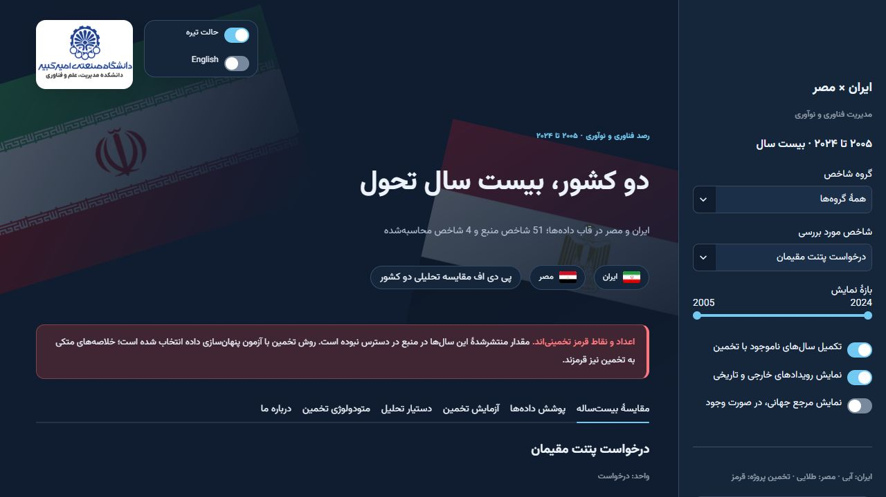

# Iran–Egypt Innovation Systems

A data-driven comparison of Iran and Egypt over **2005–2024**, built for the Technology and Innovation Management course at Amirkabir University of Technology.

**[Live dashboard](https://innovation.alaghebandnima.ir) · [راهنمای فارسی](README_FA.md) · [Data and methodology](docs/DATA_AND_METHODS.md)**



## What is included

- **55 indicators:** 51 source indicators and four calculated indicators, with definitions, units and provenance.
- Interactive comparison charts, historical annotations and downloadable Excel workbooks.
- A data-coverage view that keeps published values distinct from project estimates.
- An artificial-missingness experiment comparing weighted interpolation, regularized local trend, trend curves and a latent-state model.
- A **local Ollama assistant** using `qwen3:4b-instruct`, with short Persian/English answers grounded in the selected indicator. Numeric results come from Python; model output is checked before display.
- Persian RTL and English LTR layouts, dark/light themes, mobile support and two Persian PDF reports.

The assistant is not a web-search or causal-inference service. A larger indicator does not automatically imply better innovation performance. Model checks reduce errors but do not replace scientific review.

## Run locally

Use **Python 3.12** and install the official [Ollama](https://ollama.com/download) application. From the project directory:

```bash
python -m venv .venv
```

Windows PowerShell:

```powershell
.\.venv\Scripts\python.exe -m pip install -r requirements.txt
ollama pull qwen3:4b-instruct
.\.venv\Scripts\python.exe -m streamlit run app/dashboard.py
```

macOS/Linux:

```bash
.venv/bin/python -m pip install -r requirements.txt
ollama pull qwen3:4b-instruct
.venv/bin/python -m streamlit run app/dashboard.py
```

Open **http://localhost:8501**. Ollama must be running at `http://127.0.0.1:11434`; start `ollama serve` if its service is not already running. The model download is approximately 2.5 GB and is not committed to this repository. Once dependencies and the model are installed, the app uses the included data without fetching new data.

Optional launch helpers: `run.ps1` on Windows and `sh run.sh` on macOS/Linux.

## Resource-conscious assistant

The same 4B model is retained. Requests use a 2,048-token context, batch size 128 and two CPU threads, with one active generation at a time. A bounded disk cache retains up to 64 successful responses, and the model unloads after 30 seconds of inactivity. Fresh questions are rate-limited per session. For constrained deployments, setting `LLAMA_ARG_CACHE_RAM=0` **before starting Ollama** disables extra engine prompt snapshots. The default application cache is portable; `INNOVATION_ASSISTANT_CACHE` can override its location.

The hosted deployment uses a two-core, 4 GB server. Four recorded fresh Persian requests averaged about **85 seconds** (57–113 seconds); browser timings and other machines vary. Cached answers are usually much faster. A model error produces a warning instead of a provisional numerical answer.

## Validate and reproduce

```bash
python -m unittest discover -s app/tests -q
python scripts/audit_active_data.py
```

The current application has 59 tests covering source data, estimates, metric selection, generated-output checks and the shared answer cache. Run `python scripts/build_panel20.py` to rebuild the curated source tables, then `python scripts/build_estimates.py` to recalculate estimates and validation outputs. These commands rewrite generated files **in your checkout**. `python scripts/short_report.py` rebuilds the HTML reports. The included Excel files are release snapshots.

## Repository guide

| Path | Contents |
|---|---|
| `app/` | Streamlit interface, charts, estimation engine and Ollama integration |
| `app/tests/` | Automated tests |
| `data/panel_2005_2024/` | Source panel, completed panel and validation records |
| `data/raw/` | Curated source snapshots and source dictionary |
| `scripts/` | Rebuilding and auditing the active dataset |
| `app/assets/` | Presentation assets and PDF reports |
| `outputs/iran_egypt_2005_2024/` | Source and completed Excel workbooks |

## Project team

**Nima Alagheband** ([personal website](https://alaghebandnima.ir)) and **Amirabbas Amouzadeh**.

Course: Technology and Innovation Management. Instructor: **Dr. Sara Salimi Namin**. Teaching assistants: **Nazanin Nazem** and **Arsalan Jabbari**. [Faculty of Management, Science and Technology](https://mst.aut.ac.ir), [Amirkabir University of Technology](https://aut.ac.ir).

## Publication and attribution

This is a curated public copy. Model weights, installed runtimes, credentials, deployment access tools, logs and caches are excluded. The live application and private working folder are maintained separately. Vazirmatn is included with its OFL license; the separately supplied B Titr font is not redistributed, and headings fall back to Vazirmatn.

No project-wide open-source license has been selected. Dataset terms, model terms and third-party media rights remain separate; see [Third-party notices](THIRD_PARTY_NOTICES.md). Cite the original data providers when using the data.
